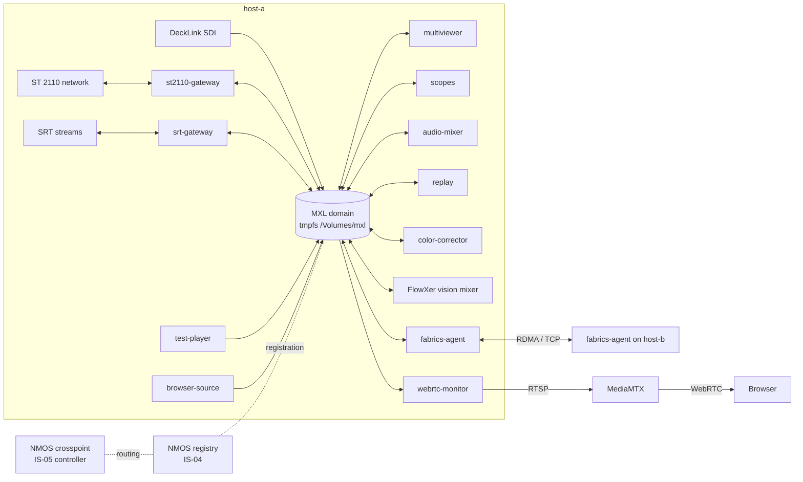

# mxl-stack

An umbrella for a set of open-source media functions built on
[MXL](https://github.com/dmf-mxl/mxl) (Media eXchange Layer, part of the EBU
Dynamic Media Facility). This repository holds no media code. It links the
function repositories, lists what a host needs, and gives Docker Compose
examples to run them together.

Each function repository stays the source of truth: its README and
SPECIFICATION document every setting, port, metric and API. If this page and a
function's README disagree, the README wins.

## What MXL is

MXL lets media functions on one host exchange uncompressed video, audio and
data through shared memory. A writer puts grains (frames) or samples into a
ring buffer in a memory-backed file system (a tmpfs); readers map the same
files. There is no copy and no network stack between functions on one host.
Grain positions are derived from TAI time, so every host needs a disciplined
clock. Between hosts, the MXL Fabrics API moves flows over RDMA (or TCP).

The functions here add the parts a facility needs around that:
AMWA NMOS IS-04/IS-05 with the MXL transport (BCP-007-03) for discovery and
routing, web UIs, Prometheus metrics, and WebRTC previews.

## Overview

- Every function is one container and one NMOS node. It writes its own MXL
  domain and reads any other domain on the host.
- A controller connects a receiver to a sender with IS-05
  (`mxl_domain_id`, `mxl_flow_id`). If that flow lives on another host, the
  fabrics agent on the receiver's host mirrors it locally.
- Browser previews are low-rate H.264 published to MediaMTX and played over
  WebRTC (WHEP).

## Media functions

FlowXer lives in its own GitHub account and has its own license (see its
repository). Images are on GitHub Container Registry. Release tags are `X.Y.Z`, `X.Y` and
`X`; there is no `latest` on most repos, so pin a version.

| Function | Purpose | Image | Version |
| --- | --- | --- | --- |
| [mxl-st2110-gateway](https://github.com/LeeO86/mxl-st2110-gateway) | SMPTE ST 2110 <-> MXL gateway on Intel E810 with MTL/DPDK, two NMOS nodes | `ghcr.io/leeo86/mxl-st2110-gateway` | 1.0.20 |
| [mxl-srt-gateway](https://github.com/LeeO86/mxl-srt-gateway) | SRT (MPEG-TS) ingest and egress to and from MXL, NVDEC/NVENC optional | `ghcr.io/leeo86/mxl-srt-gateway` | 1.4.4 |
| [mxl-decklink](https://github.com/LeeO86/mxl-decklink) | Blackmagic DeckLink SDI input and output as MXL flows | `ghcr.io/leeo86/mxl-decklink` | 1.0.7 |
| [mxl-test-player](https://github.com/LeeO86/mxl-test-player) | TAI-locked test source: video, audio, timecode, fill/key | `ghcr.io/leeo86/mxl-test-player` | 1.2.4 |
| [mxl-multiviewer](https://github.com/LeeO86/mxl-multiviewer) | Multiviewer with up to 32 inputs, tally (TSL), CPU or CUDA | `ghcr.io/leeo86/mxl-multiviewer` | 1.4.6 |
| [mxl-webrtc-monitor](https://github.com/LeeO86/mxl-webrtc-monitor) | Watch and listen to any MXL flow in a browser (WebRTC/HLS) | `ghcr.io/leeo86/mxl-webrtc-monitor` | 1.4.2 |
| [mxl-color-corrector](https://github.com/LeeO86/mxl-color-corrector) | Colour correction (gain, pedestal, saturation, gamut clip), AVX2/AVX-512 | `ghcr.io/leeo86/mxl-color-corrector` | 1.2.3 |
| [mxl-scopes](https://github.com/LeeO86/mxl-scopes) | Video scopes (waveform, parades) as an MXL flow and a WebRTC widget | `ghcr.io/leeo86/mxl-scopes` | 1.1.0 |
| [mxl-replay](https://github.com/LeeO86/mxl-replay) | Live slow-motion replay, clip player, shotbox and playlists | `ghcr.io/leeo86/mxl-replay` | 1.8.1 |
| [mxl-browser-source](https://github.com/LeeO86/mxl-browser-source) | Offscreen Chromium (CEF) web page as MXL video, key and audio; OGraf graphics | `ghcr.io/leeo86/mxl-browser-source` | 1.3.3 |
| [mxl-audio-mixer](https://github.com/LeeO86/mxl-audio-mixer) | Broadcast audio engine: matrix, channel strips, DSP, loudness, control room | `ghcr.io/leeo86/mxl-audio-mixer` | 1.4.3 |
| [mxl-fabrics-agent](https://github.com/LeeO86/mxl-fabrics-agent) | Per-host agent that mirrors flows between hosts over RDMA (MXL Fabrics) | `ghcr.io/leeo86/mxl-fabrics-agent` | 1.7.3 |
| [FlowXer](https://github.com/firesh0ot/FlowXer) | Vision mixer: up to 4 MEs, keyers and DME boxes, clip players, stingers, tally (TSL), WebRTC preview, widgets. Needs an NVIDIA GPU | `ghcr.io/firesh0ot/flowxer-vision-mixer`, `ghcr.io/firesh0ot/flowxer-gui` | 19.26.68 |

Work in progress (no image yet): [mxl-avsync](https://github.com/LeeO86/mxl-avsync),
AV sync and latency measurement (specification).

Library: [mxl-nmos](https://github.com/LeeO86/mxl-nmos) (0.1.1), a Rust NMOS
node crate (IS-04, IS-05, BCP-007-03).

### Infrastructure

| Component | Purpose | Image |
| --- | --- | --- |
| [nmos-cpp](https://github.com/sony/nmos-cpp) registry | NMOS IS-04 registry (registration and query) | `docker.io/gemini2350/nmos-cpp-registry` (pinned digest in the compose files) |
| [dmf-app-nmos-crosspoint](https://github.com/qvest-digital/dmf-app-nmos-crosspoint) | NMOS controller with a crosspoint view; connects ST 2110 and BCP-007-03 MXL senders and receivers over IS-05. Fork of [nmos-crosspoint_v3](https://github.com/Gemini2350/nmos-crosspoint_v3); see upstream for licensing | `ghcr.io/qvest-digital/dmf-app-nmos-crosspoint:4.36` |
| [MediaMTX](https://github.com/bluenviron/mediamtx) | RTSP/WebRTC/HLS server for the browser previews | `bluenviron/mediamtx:1.20.1` |

### Related projects (third party)

- [obs-mxl-plugin](https://github.com/JohannesItten/obs-mxl-plugin): OBS Studio input and output plugins for MXL.
- [Media Transport Library](https://github.com/OpenVisualCloud/Media-Transport-Library): ST 2110 over DPDK, used by the ST 2110 gateway.
- [mxl-hands-on](https://github.com/cbcrc/mxl-hands-on): MXL tutorial; the `/Volumes/mxl` tmpfs convention comes from there.

## Getting started

1. Prepare the host: [docs/requirements.md](docs/requirements.md)
   (tmpfs MXL root, TAI time, inotify limit, optional GPU).
2. Run the single-host example: [compose/single-host](compose/single-host/).
3. Two hosts over RDMA: [compose/multi-host-rdma](compose/multi-host-rdma/).
4. Kubernetes notes: [docs/kubernetes.md](docs/kubernetes.md).

## Status

These functions are proofs of concept for MXL-based production. They are
tested on real hardware, but APIs are unauthenticated by design: run them on a
protected network only.

## Contributing

See [CONTRIBUTING.md](CONTRIBUTING.md). Issues about one function belong in
that function's repository.

## License

MIT, see [LICENSE](LICENSE). Each function repository and image has its own
license and third-party notices (for example, the SRT gateway image is
GPL-2.0-or-later because it links x264 and x265).
