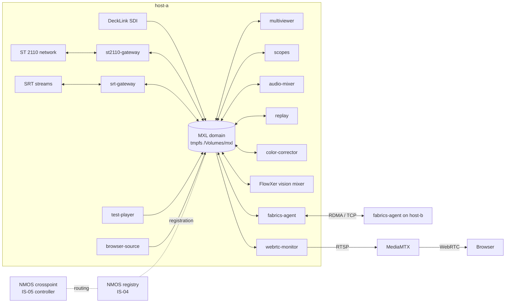

# mxl-stack

**Open-source broadcast media functions for [MXL](https://github.com/dmf-mxl/mxl)
(Media eXchange Layer), the shared-memory media exchange of the EBU Dynamic
Media Facility (DMF).** Gateways (SMPTE ST 2110, SRT, SDI), a vision mixer,
an audio mixer, replay, graphics, a multiviewer, scopes, monitoring, AV sync
measurement and multi-host replication over MXL Fabrics. Every function is a
container with AMWA NMOS IS-04/IS-05 (BCP-007-03) control, a web UI and
Prometheus metrics.

This repository is the entry point. It holds no media code: it lists the
function repositories, explains what a host needs, and gives Docker Compose
examples and Kubernetes notes to run them together.

Each function repository stays the source of truth: its README and
SPECIFICATION document every setting, port, metric and API. If this page and a
function's README disagree, the README wins.

This is an independent community project. It is not part of, or endorsed by,
the MXL project, the EBU or the Linux Foundation.

## What MXL is

MXL lets media functions on one host exchange uncompressed video, audio and
data through shared memory. A writer puts grains (frames) or samples into a
ring buffer in a memory-backed file system (a tmpfs); readers map the same
files. There is no copy and no network stack between functions on one host.
Grain positions are derived from TAI time, so every host needs a disciplined
clock. Between hosts, the MXL Fabrics API moves flows over RDMA (or TCP).

The functions here add the parts a facility needs around that:
AMWA NMOS IS-04/IS-05 with the MXL transport (BCP-007-03) for discovery and
routing, web UIs, Prometheus metrics, and WebRTC previews.

## Overview

- Every function is one container and one NMOS node. It writes its own MXL
  domain and reads any other domain on the host.
- A controller connects a receiver to a sender with IS-05
  (`mxl_domain_id`, `mxl_flow_id`). If that flow lives on another host, the
  fabrics agent on the receiver's host mirrors it locally.
- Browser previews are low-rate H.264 published to MediaMTX and played over
  WebRTC (WHEP).

## What you can build

Examples of chains made from these functions. Each arrow is an IS-05
connection made in an NMOS controller.

| Workflow | Chain | Start from |
| --- | --- | --- |
| A studio on one host | test-player or DeckLink → FlowXer (vision mixer) and audio-mixer → multiviewer, webrtc-monitor | [compose/single-host](compose/single-host/) |
| ST 2110 facility edge | ST 2110 sources → st2110-gateway → MXL functions → st2110-gateway → ST 2110 | [mxl-st2110-gateway](https://github.com/LeeO86/mxl-st2110-gateway) (needs an Intel E810) |
| Remote contribution | SRT in → srt-gateway → replay, browser-source graphics, audio-mixer → srt-gateway → SRT out | [compose/single-host](compose/single-host/) with `--profile extras` |
| Two hosts | functions on host-b read host-a's flows; the fabrics agent mirrors them over RDMA | [compose/multi-host-rdma](compose/multi-host-rdma/) |
| Measure a chain | avsync generator → chain under test → avsync analyzer (AV offset, latency); scopes for levels | [mxl-avsync](https://github.com/LeeO86/mxl-avsync) |

## Media functions

Images are on GitHub Container Registry (`ghcr.io/leeo86/<repo>`). Release
tags are `X.Y.Z`, `X.Y` and `X`; most repos have no `latest`, so pin a version.
The badges show each repository's latest release. The Compose examples pin a
set that was run together; see [CHANGELOG.md](CHANGELOG.md).

**Status.** All functions below have tagged releases, a container image and a
changelog, are tested on real hardware, and several run continuously on a
multi-host Kubernetes test platform. They are proofs of concept for MXL-based
production, not certified products. Features a README marks as planned are not
in the image yet.

### Gateways and I/O

| Function | What it does | Needs | License | Release |
| --- | --- | --- | --- | --- |
| [mxl-st2110-gateway](https://github.com/LeeO86/mxl-st2110-gateway) | SMPTE ST 2110 (-20, -30, -40, 2022-7) ↔ MXL with MTL/DPDK; two NMOS nodes | Intel E810, DPDK, hugepages, PTP | MIT |  |
| [mxl-srt-gateway](https://github.com/LeeO86/mxl-srt-gateway) | SRT (MPEG-TS) ingest and egress to and from MXL | CPU; NVDEC/NVENC optional | MIT (image GPL-2.0+, x264/x265) |  |
| [mxl-decklink](https://github.com/LeeO86/mxl-decklink) | Blackmagic DeckLink SDI input and output as MXL flows | DeckLink card, Desktop Video driver | MIT |  |

### Sources and graphics

| Function | What it does | Needs | License | Release |
| --- | --- | --- | --- | --- |
| [mxl-test-player](https://github.com/LeeO86/mxl-test-player) | TAI-locked test source: video, audio, timecode, fill/key | CPU | MIT |  |
| [mxl-browser-source](https://github.com/LeeO86/mxl-browser-source) | Offscreen Chromium (CEF) web page as MXL video, key and audio, frame-locked to TAI; OGraf graphics | CPU; NVIDIA GPU optional | MIT |  |

### Production

| Function | What it does | Needs | License | Release |
| --- | --- | --- | --- | --- |
| [FlowXer](https://github.com/firesh0ot/FlowXer) | Vision mixer: up to 4 MEs, keyers and DME boxes, clip players, stingers, tally (TSL), WebRTC preview, widgets | NVIDIA GPU | Apache-2.0 | tag `19.26.68` |
| [mxl-audio-mixer](https://github.com/LeeO86/mxl-audio-mixer) | Broadcast audio engine: routable matrix, channel strips, DSP, loudness, control room, VCAs | CPU | MIT |  |
| [mxl-replay](https://github.com/LeeO86/mxl-replay) | Live slow-motion replay, clip player, shotbox and playlists | NVIDIA GPU recommended; records and plays clips without one | GPL-3.0 |  |
| [mxl-color-corrector](https://github.com/LeeO86/mxl-color-corrector) | Colour correction (gain, pedestal, saturation, gamut clip), AVX2/AVX-512 | CPU | MIT |  |

FlowXer is developed in its own GitHub account; see its repository for
releases and licensing.

### Monitoring and measurement

| Function | What it does | Needs | License | Release |
| --- | --- | --- | --- | --- |
| [mxl-multiviewer](https://github.com/LeeO86/mxl-multiviewer) | Multiviewer with up to 32 inputs, tally (TSL), as an MXL flow | CPU; CUDA optional | Apache-2.0 |  |
| [mxl-webrtc-monitor](https://github.com/LeeO86/mxl-webrtc-monitor) | Watch and listen to any MXL flow in a browser (WebRTC/HLS) | CPU; NVENC optional | MIT |  |
| [mxl-scopes](https://github.com/LeeO86/mxl-scopes) | Video scopes (waveform, parades) as an MXL flow and a WebRTC widget | CPU (AVX2/AVX-512) | MIT |  |
| [mxl-avsync](https://github.com/LeeO86/mxl-avsync) | AV sync and latency measurement: test signal generator and analyzer; phone apps in testing | CPU | MIT |  |

### Infrastructure and libraries

| Project | What it does | Needs | License | Release |
| --- | --- | --- | --- | --- |
| [mxl-fabrics-agent](https://github.com/LeeO86/mxl-fabrics-agent) | Per-host agent that mirrors flows between hosts over MXL Fabrics, following NMOS connections | RDMA NIC (or TCP) | MIT |  |
| [mxl-nmos](https://github.com/LeeO86/mxl-nmos) | Rust crate: NMOS node (IS-04, IS-05, BCP-007-03) for MXL media functions. Early, 0.x | — | Apache-2.0 |  |

### Infrastructure used by the examples (third party)

| Component | Purpose | Image |
| --- | --- | --- |
| [nmos-cpp](https://github.com/sony/nmos-cpp) registry | NMOS IS-04 registry (registration and query) | `docker.io/gemini2350/nmos-cpp-registry` (pinned digest in the compose files) |
| [dmf-app-nmos-crosspoint](https://github.com/qvest-digital/dmf-app-nmos-crosspoint) | NMOS controller with a crosspoint view; connects ST 2110 and BCP-007-03 MXL senders and receivers over IS-05. Fork of [nmos-crosspoint_v3](https://github.com/Gemini2350/nmos-crosspoint_v3); see upstream for licensing | `ghcr.io/qvest-digital/dmf-app-nmos-crosspoint:4.36` |
| [MediaMTX](https://github.com/bluenviron/mediamtx) | RTSP/WebRTC/HLS server for the browser previews | `bluenviron/mediamtx:1.20.1` |

## Getting started

1. Prepare the host: [docs/requirements.md](docs/requirements.md)
   (tmpfs MXL root, TAI time, inotify limit, optional GPU).
2. Run the single-host example: [compose/single-host](compose/single-host/).
   It needs no special hardware: a Linux x86-64 host with Docker is enough
   for the test player, multiviewer, scopes, audio mixer, replay, browser
   source and WebRTC monitor.
3. Two hosts over RDMA: [compose/multi-host-rdma](compose/multi-host-rdma/).
4. Kubernetes notes: [docs/kubernetes.md](docs/kubernetes.md).

New to MXL itself? Start with the SDK documentation and the CBC/Radio-Canada
hands-on workshop (below), then come back here.

## Related projects

Complementary open-source work around MXL, maintained by others:

- [dmf-mxl/mxl](https://github.com/dmf-mxl/mxl): the MXL SDK, with
  [documentation](https://dmf-mxl.github.io/mxl/) and the community list
  [awesome-mxl](https://github.com/dmf-mxl/mxl/wiki/awesome%E2%80%90mxl).
- [cbcrc/mxl-hands-on](https://github.com/cbcrc/mxl-hands-on): MXL workshop
  with example media functions; the `/Volumes/mxl` tmpfs convention comes from
  there. CBC/Radio-Canada also maintain an
  [FFmpeg with MXL](https://github.com/cbcrc/guidance-for-building-ffmpeg-with-mxl)
  guide and a [CSI driver](https://github.com/cbcrc/mxl-csi) for MXL on Kubernetes.
- [EASY MXL](https://github.com/CLOUDflex-broadcast/easy-mxl): a web UI that
  creates MXL domains and launches media functions from a catalog on a Docker host.
- [qvest-digital/mxl-k8s](https://github.com/qvest-digital/mxl-k8s): a
  Kubernetes control plane for MXL, including Fabrics across nodes.
- [AMWA BCP-007-03](https://specs.amwa.tv/bcp-007-03): NMOS with MXL, the
  IS-04/IS-05 transport the functions here implement.
- [obs-mxl-plugin](https://github.com/samisb/obs-mxl-plugin): OBS Studio input
  and output plugins for MXL.
- [Media Transport Library](https://github.com/OpenVisualCloud/Media-Transport-Library):
  ST 2110 over DPDK, used by the ST 2110 gateway.

## Security

The function APIs are unauthenticated by design: run them on a protected
network only.

## Contributing

See [CONTRIBUTING.md](CONTRIBUTING.md). Issues about one function belong in
that function's repository.

## License

MIT, see [LICENSE](LICENSE). Each function repository and image has its own
license and third-party notices (see the License column above).
